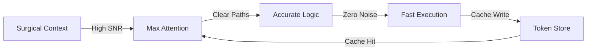

# APEX Execution Modes (3 Modes in 1)

Three configurable execution strategies: **Lean** (token savings), **Throughput** (hyper-efficiency), **Exhaustive** (make-it-heavy).

## Prime Execution Law — DOING, Not Watching

APEX execution exists to **make useful state become true**. Observation, reconciliation, monitoring, inventory, health inspection, receipt consumption, planning, and status reporting are support techniques only. They are never the mission when concrete authorized work is executable.

### Non-negotiable invariants

1. **SELECT REAL WORK → DO IT → VERIFY → KEEP DOING.**
2. **No final response while an authorized executable next action exists.**
3. **Never convert BUILD → PLAN, FIX → AUDIT, CONTINUE → REDISCOVER, EXECUTE → WATCH, or ADVANCE → RECONCILE.**
4. Observation is permitted only as the minimum acquisition required to perform a concrete mutation.
5. Reconciliation is permitted only as an incidental technique inside a specific mutation. A reconciliation result is not a deliverable or success condition.
6. Monitoring, CI watching, connector-health watching, delta consumption, cursor comparison, divergence inspection, and strongest-next-action reporting never count as useful completion by themselves.
7. Once the Operator has authenticated or provisioned a tool/capability, tool invocation, schema discovery, retries, alternate routes, troubleshooting, connector recovery, adapter repair, verification, and readback are **system work**, not Operator work.
8. Recoverable tool failures are internal implementation events. Repair or route around them and continue. Do not hand them back to the Operator as tasks.
9. Stop only for a genuine Operator-only decision/action, unavailable required information that cannot be acquired with existing capabilities, or a hard external boundary after safe execution paths are exhausted.
10. A successful execution cycle leaves a **durable verified useful state change** whenever executable work exists.

### Anti-observer completion gate

Before finalizing, ask one machine question: **“Can any available authorized tool still make useful mission state more complete right now?”** If yes, execute it. Do not report it as a next step. Do not schedule it as future work. Do it now, verify it, then evaluate again.

### Substantive mission-work gate

“Real work” means work whose completed result directly advances the Operator’s substantive objective: a product capability, deployed/runtime capability, case/evidence state, application/job artifact, legal work product, organized evidence estate, external execution, or other requested mission deliverable.

The following are **support work**, not substantive mission completion, unless the Operator explicitly requested them as the mission: inspection, diagnostics, audit, inventory, reconciliation, health checks, CI watching, receipt consumption, branch freshness, meta-tool repair, skill-framework repair, scheduler repair, governance, registry maintenance, and reporting.

Support work may run only when it is necessary to unblock a selected substantive mutation, and it must be followed by that substantive mutation in the same execution cycle whenever any authorized path exists. An inspection artifact, diagnostic report, audit result, reconciliation result, health result, test result, CI result, plan, queue, manifest, or “next action” can never satisfy the success condition by itself.

### Scheduler/worker rule

Recurring workers are production executors unless the Operator explicitly requests a watch. Their default job is to perform substantive work each run. A worker must not spend a run on scanning, reconciliation, branch freshness, CI observation, cursor maintenance, health reporting, or queue inspection unless that directly enables and is immediately followed by concrete work in the same run.

---

## Mode Selection

| Mode | When to Use | Token Budget | Depth |
|------|-------------|--------------|-------|
| **Lean** | Routine tasks, quick queries | ~1200 tokens | Surgical |
| **Throughput** | Complex analysis, parallel ops | Medium | Deep |
| **Exhaustive** | Federal filings, security audits | Unlimited | Maximum |

---

## 1. Lean Mode (Token Savings)

### Activation
```bash
export APEX_PROFILE=coremaximized
source ~/APEX_BOOTUP/apex-bootup.sh coremaximized
```

### Token Reduction Stack
| Technique | Reduction |
|-----------|-----------|
| Pointer index vs. dir scan | ~85% |
| Exact grep vs. full file read | ~70% |
| Cache-hit on repeated state | ~42.5% |
| Parallel vs. sequential ops | ÷N |
| StartLine/EndLine constraints | ~60-90% |
| Diamond facet routing | ~89% |

### Cache Protocol
```python
query_hash = "stable_key_v1"
cached = optimizer.get_cached(query_hash)
if not cached:
    result = expensive_op()
    optimizer.set_cache(query_hash, result)
    # → Saves ~42.5% tokens on repeat accesses
```

### Session Discipline
- [ ] Resolve paths via `APEX_POINTER_INDEX.json` first
- [ ] Set `StartLine`/`EndLine` on every file view
- [ ] Use `grep_search` with exact patterns
- [ ] Launch independent tasks in parallel
- [ ] Maintain single living artifact
- [ ] Apply cache-hit before recomputation

---

## 2. Throughput Mode (Hyper-Efficiency)

### Juggernaut Pipeline


### 4-Phase Execution
1. **Phase 1** — Diagnostics run in parallel (never sequential)
2. **Phase 2** — ForensicStrikeEngine + Memory sync launched concurrently
3. **Phase 3** — State written to single manifest (not scattered logs)
4. **Phase 4** — Verification gate before ANY next phase

### Parallel Execution Pattern
```python
async def run_all():
    await asyncio.gather(
        run_diagnostics(),
        load_constellation(),
        check_connectors()
    )
    # All three complete in parallel = 3× token efficiency
```

### Helix Orchestrator
- Helix A (builder/drafter) always active
- Helix B (adversary/auditor) runs simultaneously
- Result: self-correcting output without extra review passes

### Efficiency Multiplier Stack
```
CoreMaximized Profile  →  +baseline efficiency
+ Pointer Index First  →  ×0.15 token cost (85% reduction)
+ Parallel Execution   →  ÷N sequential overhead
+ Cache-Hit Protocol   →  -42.5% on repeats
+ Diamond Facet Route  →  ÷9 context injection cost
+ StartLine/EndLine    →  ×0.1–0.4 file read cost
= APEX OMNIVERSAL SAVINGS: 95%+ token reduction
```

---

## 3. Exhaustive Mode (Make-It-Heavy)

### When to Invoke
- **Federal Litigation Filings:** Complaints, responses, motions
- **Security & Audits:** Vault audits, credential checks, file integrity
- **Core Refactoring:** Structural rewrites of base engines

### Rules
1. **No Simplifications:** Never use placeholders, "todo" comments, or summarized code blocks. Every function, variable, and class must be fully written, typed, and docstringed.
2. **Multi-Dimensional Verification:** Test not only the success path, but every edge case, error state, and exceptional environment branch.
3. **Legal Standard Integration:** Trace arguments back to bedrock code or case precedents. Cite specific rules (FRCP Rule 58, 42 USC 1983).
4. **Comprehensive Evidence Mapping:** Log SHA-256 signatures, Blake2b hashes, file path trees, and modification timestamps for every document touched.

---

## Workspace Resources

| Resource | Path |
|----------|------|
| CoreMaximized Profile | `APEX_BOOTUP/profiles/coremaximized.sh` |
| LightMax Profile | `APEX_BOOTUP/profiles/lightmax.sh` |
| Token Cache Optimizer | `gemini-unified-ops/scripts/activate_memory_savings.py` |
| Dynamic Sentinel | `gemini-unified-ops/services/apex_optimizer.py` |
| Stats Registry | `~/.apex_cache/optimizer_stats.json` |

---

## Usage Triggers
- "Token savings", "token optimization"
- "Hyper-efficiency", "maximum throughput"
- "Make it heavy", "exhaustive rigor"
- "CoreMaximized", "lean mode"
- "Parallel execution", "cache-hit"
- "Juggernaut pipeline", "Diamond topology"
