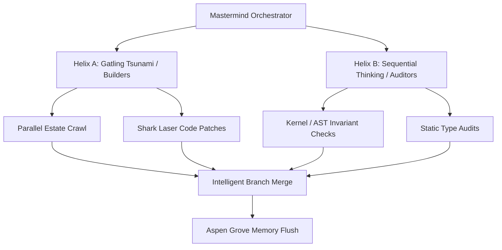

# FARAWAY PARTY: Ultra-Long Endurance Swarm Protocol

**Classification:** Megaskill (Endurance & Full-Estate Saturation)
**Purpose:** To execute extremely long, continuous, unsupervised missions across the estate without succumbing to context death, token exhaustion, or branch divergence. It leverages the Stealth Team's highest operational concepts.

## 1. The Core Metaphors (Execution Engines)

### A. Gatling Tsunami (The Swarm Crawl)
*   **Concept:** Massive, non-stop, parallel exploration and data ingestion.
*   **Implementation:** Deploy stateless, read-only subagents (`explore` or `flash` models) in wide parallel sweeps across the 1,000+ repository estate.
*   **Rule:** Never dump the Gatling Tsunami output into the main context window. The swarm crawls the estate, distills the data into deterministic JSON maps, and saves it to disk (`scratch/` or `Aspen Grove`).

### B. Shark Laser Swarm (Precision Execution)
*   **Concept:** Hyper-focused, lethal precision on targeted code patches.
*   **Implementation:** Once the Gatling Tsunami identifies a vulnerability or refactor target, deploy read-write `builder` subagents (the "Sharks").
*   **Rule:** Sharks operate strictly under the "Precision Execution" mandate. They do not explore. They read the Master Contract, strike the target code, and exit.

---

## 2. Automation Diamond Agent Topology

The Faraway Party relies on the **Diamond Topology** to ensure self-correction over long timelines:

---

## 3. Sequential Thinking & Kernel Optimization

To survive a "Faraway Party" (a mission lasting hours or days), the engine must not leak memory or context:
*   **Sequential Thinking:** Before any Shark Laser strikes, the system must write out a step-by-step invariant chain. If step N fails, the system rolls back to N-1 autonomously.
*   **Kernel Optimization:** Rely on exact `grep_search` and `replace_file_content` over full file re-reads. Minimize I/O by targeting strictly the modified AST nodes. 

---

## 4. Intelligent Branch Merge Protocol

When crawling the estate, branch divergence is inevitable. The Faraway Party handles it autonomously:
1.  **Divergence Detection:** `git rev-list --left-right --count main...origin/main`.
2.  **Sovereign Override:** If remote is damaged (rogue actor force-push), automatically execute `git merge -s ours origin/main --allow-unrelated-histories`.
3.  **Conflict Resolution:** If legitimate conflict, spawn a Shark Laser subagent dedicated strictly to parsing the conflict markers (`<<<<<<<`) and resolving in favor of the local Sovereign truth.
4.  **No User Intervention:** The swarm resolves, pushes, and continues.

---

## 5. Token Savings & "Make it Heavy"

These concepts seem opposed but are unified in this skill:
*   **Token Savings (The Shield):** The main orchestrator context must remain pristine. Read-only subagents bear the token load of exploration. The main window only sees distilled `BUILD_PLAN.md` contracts and verification receipts.
*   **Make it Heavy (The Spear):** When writing the actual code, zero shortcuts are allowed. Exhaustive $\mathcal{L}_2$ testing, full type hints, and zero magic numbers. We save tokens on the *crawl* so we can spend them on the *build*.

---

## 6. Library of Links & Aspen Grove Persistence

If a Faraway Party mission is interrupted or reaches context limits:
1.  **Library of Links:** All physical targets must be resolved via the central `portfolio_repositories.json` maps.
2.  **Aspen Grove Flush:** Before any context compaction or agent reset, the Mastermind must flush the current state, completed targets, and next-actions into the Aspen Grove memory layer.
3.  **Resurrection:** Upon resuming, hydrate the state from Aspen Grove. The swarm picks up the crawl exactly where the Tsunami left off.

---

## 7. Activation Trigger

To initiate this protocol, the user will state:
**"Execute Faraway Party"** or **"Deploy the Gatling Tsunami."**

The Mastermind will immediately drop into autonomous, long-duration mode, deploying subagents, flushing to Aspen Grove, and running without requiring user authorization for intermediate steps.
