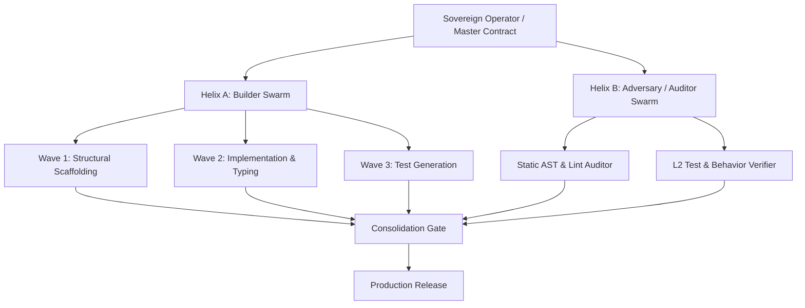
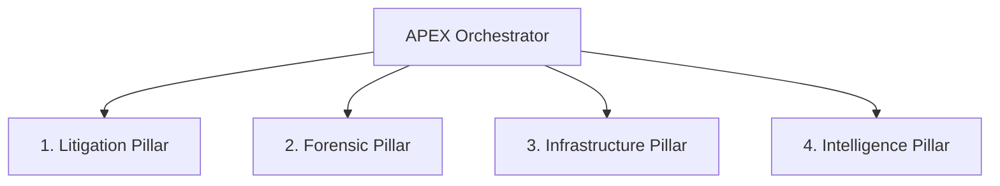

# MEGA-APEX-SOVEREIGN-MASTERMIND

> [!WARNING]
> **APEX COGNITIVE FIREWALL (INTERCEPTOR GATE)**
> This file contains the complete APEX Sovereign Mastermind execution framework, 12 Pistons, and Swarm protocols.
DO NOT READ FURTHER unless the current user mandate explicitly requires:
- APEX execution modes (Lean/Throughput/Exhaustive), swarming orchestration, or epistemic methodology.
> If the current task does not specifically target this domain, **STOP READING HERE** to preserve token context.


## Sub-Skill: apex-execution-modes
# APEX Execution Modes (3 Modes in 1)

Three configurable execution strategies: **Lean** (token savings), **Throughput** (hyper-efficiency), **Exhaustive** (make-it-heavy).

---

## Mode Selection

| Mode | When to Use | Token Budget | Depth |
|------|-------------|--------------|-------|
| **Lean** | Routine tasks, quick queries | ~1200 tokens | Surgical |
| **Throughput** | Complex analysis, parallel ops | Medium | Deep |
| **Exhaustive** | Federal filings, security audits | Unlimited | Maximum |

---

## 1. Lean Mode (Token Savings)

### Activation
```bash
export APEX_PROFILE=coremaximized
source ~/APEX_BOOTUP/apex-bootup.sh coremaximized
```

### Token Reduction Stack
| Technique | Reduction |
|-----------|-----------|
| Pointer index vs. dir scan | ~85% |
| Exact grep vs. full file read | ~70% |
| Cache-hit on repeated state | ~42.5% |
| Parallel vs. sequential ops | ÷N |
| StartLine/EndLine constraints | ~60-90% |
| Diamond facet routing | ~89% |

### Cache Protocol
```python
query_hash = "stable_key_v1"
cached = optimizer.get_cached(query_hash)
if not cached:
    result = expensive_op()
    optimizer.set_cache(query_hash, result)
    # → Saves ~42.5% tokens on repeat accesses
```

### Session Discipline
- [ ] Resolve paths via `APEX_POINTER_INDEX.json` first
- [ ] Set `StartLine`/`EndLine` on every file view
- [ ] Use `grep_search` with exact patterns
- [ ] Launch independent tasks in parallel
- [ ] Maintain single living artifact
- [ ] Apply cache-hit before recomputation

---

## 2. Throughput Mode (Hyper-Efficiency)

### Juggernaut Pipeline


### 4-Phase Execution (Tower of Babel Pattern)
1. **Phase 1 (Research)** — Parallel diagnostics/subagents gather facts. Never sequential. Read-only.
2. **Phase 2 (Planning)** — Write a single Master Contract (`BUILD_PLAN.md`).
3. **Phase 3 (Execution)** — Dispatch builders in parallel to execute the plan blindly. Zero hallucination. Zero repeated research.
4. **Phase 4 (Verification)** — Anti-Fragility Dual-Path Gate (Run Native if available, else static AST verification).

### Parallel Execution Pattern
```python
async def run_all():
    await asyncio.gather(
        run_diagnostics(),
        load_constellation(),
        check_connectors()
    )
    # All three complete in parallel = 3× token efficiency
```

### Helix Orchestrator
- Helix A (builder/drafter) always active
- Helix B (adversary/auditor) runs simultaneously
- Result: self-correcting output without extra review passes

### Efficiency Multiplier Stack
```
CoreMaximized Profile  →  +baseline efficiency
+ Pointer Index First  →  ×0.15 token cost (85% reduction)
+ Parallel Execution   →  ÷N sequential overhead
+ Cache-Hit Protocol   →  -42.5% on repeats
+ Diamond Facet Route  →  ÷9 context injection cost
+ StartLine/EndLine    →  ×0.1–0.4 file read cost
= APEX OMNIVERSAL SAVINGS: 95%+ token reduction
```

---

## 3. Exhaustive Mode (Make-It-Heavy)

### When to Invoke
- **Federal Litigation Filings:** Complaints, responses, motions, evidentiary matrices
- **Security & Audits:** Vault audits, credential scrubs, integrity verifications
- **Core Refactoring:** Base engine rewrites, runtime kernel hardening
- **Estate Recovery & Consolidation:** Full-portfolio alignment, branch consolidation, quality elevation

---

### Core Engineering Invariants (The Solid Standard)
1. **Zero Simplifications:** Never use placeholders, `TODO` comments, or stubbed code blocks. Every function, parameter, and class must be fully written, strongly typed, and docstringed.
2. **Multi-Dimensional Verification:** Test not only happy paths, but every edge case, boundary error, network timeout, and malformed state.
3. **Anti-Fragile Dual-Path Architecture:** Always provide a verified fallback path (e.g. if an external toolchain is unavailable, execute deterministic static AST validation to prove behavioral contract).
4. **Legal & Evidence Standard Integration:** Trace all claims to bedrock code, case law, or signed cryptographic hashes (SHA-256 / Blake2b).
5. **No Blind Deletions or Overwrites:** Local workspaces are preserved until upstream verification is 100% cryptographically proven.

---

### Diamond Swarm Orchestration Protocol
When tasks require massive breadth or deep multi-agent coordination, dispatch structured swarms:



1. **Dual-Helix Division of Labor**:
   - **Helix A (Builder Lane)**: Writes full implementation, interfaces, types, and docs.
   - **Helix B (Adversary Lane)**: Simultaneously runs AST verification, checks failure paths, and writes adversarial tests.
2. **Sequential Wave Execution**:
   - **Wave 1 (Research & Structure)**: Read-only subagents map the territory.
   - **Wave 2 (Execution & Hardening)**: Builders implement with zero stubs.
   - **Wave 3 (Verification & Reconciliation)**: Adversaries run tests and certify L2 behavior before release.

---

### Sovereign Branch Consolidation Matrix
When consolidating repositories with complex branch histories:

1. **Automated 6-Tier Branch Classification**:
   | Branch Tier | Identification | Consolidation Strategy |
   |-------------|----------------|------------------------|
   | **PRIMARY** | `main`, `master` | Target trunk for all merged work. Protected by pre-push hooks. |
   | **APEX_ASCENSION** | `apex/sovereign-ascended-*` | **Preserve indefinitely** as historical proof. Never delete. |
   | **FEATURE** | `feature/*`, `feat/*` | Check divergence vs `main`. If commits are missing on `main`, cherry-pick/merge cleanly, then retire branch. |
   | **FIX** | `fix/*`, `hotfix/*`, `chore/*` | Verify patch exists upstream. Merge forward; do not revert. |
   | **RELEASE** | `release/*`, `v*` | Tag commit with annotated GPG/Git tag, merge to `main`. |
   | **LEGACY / DIVERGENT** | `backup/*`, `old/*` | Retain in remote reflog or archive branch; do not force-delete. |

2. **Divergence & Loss-Prevention Gating**:
   - **Step 1 (Fetch Remote Map)**: `git fetch --all --prune`
   - **Step 2 (Divergence Check)**: Run `git log --left-right --graph --cherry-mark <branch>...origin/main` to identify unique commits.
   - **Step 3 (Reconciliation Merge)**: Merge unique commits to `main` via fast-forward or verified merge commit.
   - **Step 4 (Test Verification)**: Execute local test suite before pushing upstream.
   - **Step 5 (No Force-Push Rule)**: Never use `git push --force`. All pushes must be standard fast-forwards verified by the global pre-push hook.

---

### Estate Quality Elevation Waves
1. **Wave 1 — Credibility Foundation**: Scrub plaintext tokens, remove dangerous aliases, fix broken TOML/configs, resolve git merge conflict markers.
2. **Wave 2 — Code Excellence**: Eliminate syntax errors, fix failing test suites, achieve 100% pytest pass rates, ensure robust typing.
3. **Wave 3 — Verification & Evidence Ledger**: Record Blake2b/SHA-256 receipts, generate L2 execution proofs, commit clean documentation.

---


## Remote Sources (GitHub — Stable)
| Resource | Remote Source |
|----------|----------------|
| Estate Map | [`GlacierEQ/monolith`](https://github.com/GlacierEQ/monolith) |
| Epistemic Methodology | [`monolith/foundations/epistemic-methodology.md`](https://github.com/GlacierEQ/monolith/blob/main/foundations/epistemic-methodology.md) |
| Excellence Standard | [`monolith/foundations/EXCELLENCE.md`](https://github.com/GlacierEQ/monolith/blob/main/foundations/EXCELLENCE.md) |
| Helix Spiral + Anti-Minimization | [`monolith/foundations/helix-spiral.md`](https://github.com/GlacierEQ/monolith/blob/main/foundations/helix-spiral.md) |
| Memory Layer | [`GlacierEQ/aspen-grove-core`](https://github.com/GlacierEQ/aspen-grove-core) |
| Memory Connectors | [`GlacierEQ/aspen-grove-connectors`](https://github.com/GlacierEQ/aspen-grove-connectors) |
| Tower of Babel (Polyglot) | [`GlacierEQ/the-tower-of-babel`](https://github.com/GlacierEQ/the-tower-of-babel) |
| Bootup Core | [`GlacierEQ/apex-bootup-core`](https://github.com/GlacierEQ/apex-bootup-core) |
| Pro Code Doctrine | [`GlacierEQ/Pro_Code`](https://github.com/GlacierEQ/Pro_Code) |
| Swarm Orchestrator | [`GlacierEQ/stealth-swarm-orchestrator`](https://github.com/GlacierEQ/stealth-swarm-orchestrator) |
| Mastermind | [`GlacierEQ/mastermind`](https://github.com/GlacierEQ/mastermind) |
| Legal Warfare | [`GlacierEQ/mastermind-law`](https://github.com/GlacierEQ/mastermind-law) |
| MCP Everything Server | [`GlacierEQ/everything-mcp-server`](https://github.com/GlacierEQ/everything-mcp-server) |
| Full Estate (1,183 repos) | [`github.com/GlacierEQ`](https://github.com/GlacierEQ) |

> **Resolution rule:** Local clones are ephemeral caches of the living remote. If a local path is dead, fetch from the GitHub source via `gh api`. Never hardcode local paths as the source of truth.

---

## Usage Triggers
- "Token savings", "token optimization"
- "Hyper-efficiency", "maximum throughput"
- "Make it heavy", "exhaustive rigor"
- "CoreMaximized", "lean mode"
- "Parallel execution", "cache-hit"
- "Juggernaut pipeline", "Diamond topology"

---

## Sub-Skill: apex-orchestration
# APEX Orchestration (Complete Operational Framework)

Single skill covering: pistons, mission packets, Alpha/Omega strands, sovereign protocol, AGI agent swarm, strategic pillars, and navigation.

---

## Architecture

```
APEX ORCHESTRATOR
├── 12 Pistons (Ring -3) — hidden execution layer
├── Mission Packets — stage-gated workflow
├── Double Helix — Alpha (What) ↔ Omega (How)
├── 4 Strategic Pillars — Legal, Forensic, Infrastructure, Intelligence
├── 35 AGI Agents — sovereign swarm
└── Library of Links — navigation map
```

---

## 1. 12 Pistons (Ring -3)

Execute below OS, below hypervisor, before domain master fires.

| Tier | Pistons |
|------|---------|
| **APEX** | MICROWAVE, SUPERNOVA, CORE-THINK, BODYBUILDER |
| **BLACK** | SHERLOCK, SONIC, GHOST, PHANTOM |
| **GREY** | VIPER, WRAITH, SPECTER, SHADOW |

### Piston Execution
```python
from piston_registry import PistonRegistry
registry = PistonRegistry()

# Single piston
result = registry.execute_piston(name="MICROWAVE", params={"target": "optimization"})

# Fusion mode
result = registry.execute_fusion(mode="APEX_FUSION", pistons=["MICROWAVE", "SUPERNOVA", "CORE-THINK"])
```

### Fusion Modes
| Mode | Pistons | Use Case |
|------|---------|----------|
| APEX_FUSION | MICROWAVE + SUPERNOVA + CORE-THINK | Maximum intelligence |
| BLACK_OPS | SHERLOCK + SONIC + GHOST + PHANTOM | Stealth operations |
| GREY_AREA | VIPER + WRAITH + SPECTER + SHADOW | Subtle manipulation |
| FULL_POWER | All 12 | Complete system saturation |

---

## 2. Mission Packets (Stage Gates)

```
INTAKE → PLAN → REVIEW → APPROVED → EXECUTING → COMPLETE
```

```python
from mastermind_orchestrator import MastermindOrchestrator
orchestrator = MastermindOrchestrator()

# Create and process
packet = orchestrator.create_mission(
    title="Legal Analysis",
    priority="high",
    required_engines=["legal-automation", "pattern-analysis"]
)
orchestrator.process_packet(packet.id)
```

---

## 3. Double Helix (Alpha/Omega)

### Alpha Strand (What) — Port :8741
- Recognition, understanding, categorization, flagging
- 21 engines: legal, forensic, pattern analysis
- Repo: `apex-alpha`

### Omega Strand (How) — Port :8002
- Execution, processing, completion, heavy lifting
- 13 workers: motion-generator, case-analyzer
- Repo: `apex-omega`

### Inter-Strand Communication
```python
from double_helix_api import DoubleHelix
helix = DoubleHelix()

# Alpha calls Omega
result = helix.omega.executeWorker(name="motion-generator", capability="generateMotion", params={"type": "section_1983"})

# Omega calls Alpha
result = helix.alpha.executeWorkflow(name="legal_case_package", params={"case_id": "1FDV-23-0001009"})

# Health check
health = helix.health()  # { alpha: HealthStatus, omega: HealthStatus }

# Evolution tracking
evolution = helix.getEvolutionLog()  # EvolutionEvent[]
```

**Isolation Principle:** Refactors in one strand don't disturb the other. Contract is the shield.

---

## 4. Four Strategic Pillars



### Pillar 1: Litigation (Legal Weaver)
- Motion generation, RICO analysis, FRCP compliance
- Resources: `apex-fs-commander`, `CORE_MISSION/AspenGrove-KEKOA-1FDV-23-0001009`

### Pillar 2: Forensic (Veritas Sentinel)
- Evidence chain, SHA-256 validation, audit trails
- Resources: `categorize_evidence.py`, `ingest_titan.py`

### Pillar 3: Infrastructure (Microwave Core)
- Service orchestration, MCP mapping, full-power saturation
- Resources: `microwave_full_power.py`, `singularity_v5`

### Pillar 4: Intelligence (Chrono Scryer)
- Timeline alignment, metadata contradictions, memory tracking
- Resources: `apex-gateway/codex_weaver.py`, `omni.sh`

---

## 5. Sovereign Protocol (35 AGI Agents)

```json
{
  "connection_manifest": "UNIVERSAL_OPERATOR_BRIDGE_V15_QUANTUM_NEXUS",
  "activation_phrase": "Expand. Interlink. Ascend. The Operator is the Universe."
}
```

### Core Agent Swarm
| Agent | Function |
|-------|----------|
| quantum-detector | Case thread orchestration |
| echo-mapper | Memory synthesis |
| legal-weaver | Filesystem operations |
| veritas-sentinel | Contradiction detection |
| chrono-scryer | Timeline prediction |

### Stability Rules
1. `entropy_stabilizer_v5` — Process synchronization
2. `veritas_contradiction_detection` — Cross-validation
3. `soulburst_recovery` — Self-healing on faults

---

## 6. Library of Links (Navigation)

Cross-repo navigation map for all APEX resources:
- Mission directories
- Engine registries
- Worker pools
- Contract definitions
- Memory stores

---

## Integration Points

| Component | Endpoint |
|-----------|----------|
| Mastermind API | `POST /api/workflow/apex-orchestration` |
| Piston Registry | `~/mastermind/pistons_registry.yml` |
| Alpha Client | `http://localhost:8741` |
| Omega Client | `http://localhost:8002` |
| Contracts | `apex-alpha/contracts/`, `apex-omega/contracts/` |

---

## Usage Triggers
- "Execute piston", "Run fusion mode"
- "Mission packet", "Stage gate"
- "Double Helix", "Alpha/Omega"
- "APEX orchestration", "Sovereign protocol"
- "Strategic pillar", "AGI agent"
- "Dynamic assignment", "Contract validation"

---

## Sub-Skill: apex-sovereign-swarm-core
# APEX Sovereign Swarm Core

Unified specification governing agent execution modes, multi-agent orchestrations, and mastermind control structures.

## 1. APEX Execution Profiles

| Profile | Purpose | Token Strategy |
|---|---|---|
| **Lean** | Routine updates, surgical edits | Pointer index first, exact grep, StartLine/EndLine |
| **Throughput** | Parallel analysis, self-audits | Double Helix (Alpha + Omega), concurrent diagnostic checks |
| **Exhaustive** | Rigorous audits, critical code bases | Zero placeholders, strict validation |

## 2. Multi-Agent & Antigravity Orchestrations
- Use `sync.WaitGroup` in Go or `asyncio.gather` in Python to parallelize operations.
- **Double Helix Pattern:** Concurrently run builder (Helix A) and auditor (Helix B) agents on the same context to achieve self-correcting output.
- **Diamond Topology:** Route context through specific facets instead of injecting a monolithic payload.

---

## Sub-Skill: code-excellence-staff-engineer
# Code Excellence & Google Senior Staff Engineer Standard

Defines the absolute bar for software engineering across the entire APEX estate. Follows the **Pro Code Philosophy**: *"Take what exists, make it better. The wheel is knowledge. Four wheels on a chassis is innovation."*

---

## 1. Core Engineering Commandments

1. **Zero Magic Numbers & Strings**:
   - Every scalar constant, timeout, port, batch size, or regex must be extracted into a strictly typed, named constant or self-documenting configuration enum.
2. **Production-Grade, Never Prototype**:
   - Write every function as if it will run in a tier-0 production pipeline under high concurrency.
   - No `TODO(later)` in committed paths without an issue link or fallback handler.
3. **Explicit Invariant Defense**:
   - Validate pre-conditions and post-conditions at method boundaries.
   - Fail closed, fail fast, and bubble structured error contexts with complete causation chains.
4. **Interface Segregation & Cohesion**:
   - Design narrow, decoupled interfaces. Prefer composition over inheritance.
   - Keep side effects strictly isolated from pure domain logic.

---

## 2. Code Review & Implementation Checklist

| Dimension | Standard | Violation Example (Forbidden) |
| :--- | :--- | :--- |
| **Constants** | Explicit named enum / frozen dataclass / typed const | `time.sleep(5)` or `port = 8741` inline |
| **Error Handling** | Domain-specific exceptions with causes (`from err`) | `except Exception: pass` or bare `print(e)` |
| **Types** | 100% strict type hints / TypeScript strict / Go interfaces | `any`, `dict[str, Any]` without schemas |
| **Telemetry** | Structured JSON logs with trace/span/session IDs | Raw unstructured `print()` or `console.log()` |
| **Documentation** | Self-documenting signature + docstring with invariants | Missing parameter/return explanations |

---

## 3. Polyglot Standards

### Python (APEX Core & ML)
```python
from dataclasses import dataclass
from typing import Final

DEFAULT_TIMEOUT_MS: Final[int] = 5_000
MAX_RETRY_ATTEMPTS: Final[int] = 3

@dataclass(frozen=True)
class ExecutionResult:
    status_code: int
    payload: bytes
    is_success: bool

    def validate(self) -> None:
        if self.status_code < 200 or self.status_code >= 600:
            raise ValueError(f"Invalid status code encountered: {self.status_code}")
```

### TypeScript / Next.js / React
```typescript
export const ENGINE_CONFIG = Object.freeze({
  DEFAULT_PORT: 8741,
  HEALTH_CHECK_INTERVAL_MS: 10_000,
} as const);

export type EngineConfig = typeof ENGINE_CONFIG;
```

---

## 4. Full-Story Verification
- Never claim a task complete without executing end-to-end verification (static analysis -> unit/integration tests -> runtime execution proof).

---

## Sub-Skill: frontier-genius-protocol
# Frontier Genius & Long-Run Endurance Protocol

Governs the highest-stakes, longest-duration autonomous engineering workflows. Guarantees zero-hallucination, zero context bloat, and deterministic completion across complex polyglot estates.

---

## 1. The Tower of Babel Execution Lifecycle

```
[Phase 1: Stateless Research] ──→ [Phase 2: Master Contract (BUILD_PLAN.md)] ──→ [Phase 3: Blind Execution] ──→ [Phase 4: Multi-Model Audit]
   (Subagents explore context)       (Single source of truth locked)              (Builders execute verbatim)      (Self-healing verification)
```

1. **Stateless Research**: Dispatch read-only explore subagents. Do not pollute the main context window with raw file reads.
2. **Master Contract**: Synthesize all discoveries into a single `BUILD_PLAN.md` artifact with exact line numbers and target state.
3. **Blind Execution**: Dispatch builder subagents whose sole prompt is: *"Read the BUILD_PLAN and execute exactly what is written. Do not re-research."*
4. **Multi-Model / Double Helix Audit**: Helix B validates Helix A output against the invariant proofs before closing the packet.

---

## 2. Checkpointing & State Persistence

Every mission packet maintains an on-disk atomic state:
- **Location**: `~/.apex_cache/checkpoints/<packet_id>.json`
- **Cadence**: Persisted immediately before and after any irreversible I/O, migration, or multi-file refactor.
- **Rollback Invariant**: If an unhandled exception or audit failure occurs, state reverts to the last verified snapshot.

---

## 3. Autonomous Deadlock Breaking

- If Helix B (Auditor) rejects Helix A (Builder) 3 consecutive times:
  1. Trigger immediate context compaction and memory flush.
  2. Generate a root-cause diff analysis between the expected contract and actual state.
  3. Dispatch an alternate synthesis strategy rather than re-attempting the failed patch.

---

## Sub-Skill: glacier-eq-mastermind
# GlacierEQ Mastermind Skill

**Goal**: Coordinate and maximize intelligence operations by orchestrating the Aspen Grove memory uplinks, sovereign swarm systems, and the 12 Pistons Elite Capability Matrix.


## Remote Repositories
| System | Remote Source |
|--------|----------------|
| Aspen Notion Bridge | [`GlacierEQ/aspen-grove-connectors`](https://github.com/GlacierEQ/aspen-grove-connectors) |
| Infinity Gauntlet | [`GlacierEQ/mastermind`](https://github.com/GlacierEQ/mastermind) |
| 12 Pistons Matrix | [`GlacierEQ/mastermind`](https://github.com/GlacierEQ/mastermind) |
| Memory Ecology | [`GlacierEQ/aspen-grove-memory`](https://github.com/GlacierEQ/aspen-grove-memory) |

## Operational Standards

### 1. Unified Uplink Configuration
- Fetch session registry from `GlacierEQ/aspen-grove-connectors` via `gh api`.
- Keep session states synchronized with the central Aspen Grove metadata graph.

### 2. Gauntlet System Snapping
- Engage stones sequentially for infrastructure, logic, skills, agents, memory, and keys.
- Fetch implementation from `GlacierEQ/mastermind` living source.

### 3. The 12 Pistons Execution (Ring -3)
Implement specialized protocols utilizing the 12 Pistons:
- **MICROWAVE**: Parallel hyperspeed batching.
- **SUPERNOVA**: Force deployment & system lockdowns.
- **CORE-THINK**: Quantum-fingerprinted reasoning engine.
- **BODYBUILDER**: Scale memory & filesystem integrity (100 Folder System).
- **SHERLOCK-ALPHA**: Forensic intelligence (proof-of-delay detection).
- **SONIC**: Zero-copy interaction.
- **GHOST**: Zero-trace execution via **Harmonious Denial** protocols.
- **PHANTOM**: Persistent evolutionary engines.
- **VIPER**: Precision code-patching.
- **WRAITH**: RAM-volatile GUI/UI operations.
- **SPECTER**: Async event handling on speculative execution channels.
- **SHADOW**: Monitor of monitors.

## Session Command Sequence
1. Hydrate context from Aspen Grove: `gh api repos/GlacierEQ/aspen-grove-core/readme -H "Accept: application/vnd.github.raw"`
2. Fetch mastermind config: `gh api repos/GlacierEQ/mastermind/contents/pistons_registry.yml -H "Accept: application/vnd.github.raw"`
3. Execute local task loops with token-saver rules.
4. Flush session state back to Aspen Grove before compaction.

---

## Sub-Skill: token-saver
# Token Saver Skill

**Core goal**: Keep the active context window lean, cheap, and effective by externalizing knowledge (skills + memory), delegating (subagents), compressing (compact + concise), and pruning aggressively.

Activate this skill to enforce token discipline on yourself and future turns.

## The "Plan-Then-Execute" Protocol (Tower of Babel Pattern)
When undertaking massive architectural builds across multiple domains (e.g., polyglot systems, large migrations):
1. **Decouple Research:** Deploy parallel, stateless subagents (read-only) to gather context and syntax. Do NOT dump this into the main window.
2. **Master Contract:** Condense findings into a single, rigorous `BUILD_PLAN.md` artifact.
3. **Blind Execution:** Dispatch builder subagents whose sole prompt is: *"Read the BUILD_PLAN and execute exactly what is written. Do not re-research."*
4. **Result:** Zero hallucination, zero wasted tokens on re-discovery. 100% execution fidelity.

## Always-On Rules When This Skill Is Active

1. **Lead with substance, cut filler** — First sentence = the answer/outcome. Then structure with bullets/tables. Never open with "Let me...", "Sure...", "To do X...".

2. **Use lists and tables aggressively** for parallel items, comparisons, file:line status, options.

3. **Delegate liberally**:
   - Use `spawn_subagent` with `subagent_type: "explore"` or `"plan"` for research/planning.
   - Apply persona "concise" where possible by instructing the child (or rely on config).
   - Use `background: true` for independent work; retrieve later with `get_command_or_subagent_output`.
   - Capability modes: `read-only` or `read-write` to limit bloat.

4. **Proactive compaction & memory**:
   - Before context gets heavy, call `/compact` (or let auto-compact at the lowered 75% threshold).
   - Before compacting: run `/flush` to save key decisions/patterns to memory.
   - After compaction or at session boundaries, suggest or run `/dream` (if memory enabled).
   - Prefer injecting memory facts over re-pasting long history or past explanations.

5. **Leverage remove-wall-of-text**:
   - After any long or dense response, if the user complains about length or you notice bloat, immediately follow up by invoking the `/remove-wall-of-text` skill (or equivalent concise rewrite) on the prior output.
   - Internally, before emitting a long block, self-condense using the principles from the remove-wall-of-text skill.

6. **Externalize with skills**:
   - Capture repeatable procedures into new skills via `/create-skill` instead of repeating instructions.
   - Prefer project-scoped (`.grok/skills/`) skills when working in a repo for team benefit.
   - When you see repeated explanations, propose extracting a skill.

7. **Tool result discipline**:
   - Large outputs: rely on pruning and disk truncation (already built-in).
   - Summarize tool results yourself in 2-4 bullets when returning to user.
   - Use `todo_write` early and update often instead of describing state in prose.

8. **Prompt style for user & self**:
   - Ask users for concise directives when possible.
   - When spawning or continuing, pass "use concise persona / follow token-saver rules" in child prompts.
   - End substantive replies with a very short "Next: ..." action line only when needed.

## Workflow for a Long Session

- Start important work → `/flush` key context early.
- Research heavy? Spawn explore subagents (read-only, concise).
- Implementation? Use plan subagent first, then focused general-purpose.
- Before any big edit batch or many turns → consider `/compact`.
- User says "too long" → immediately run remove-wall-of-text rewrite.
- End of productive block → `/flush` + suggest `/dream`.

## Configuration You Should Have (reference)

- `auto_compact_threshold_percent = 75` (or lower)
- `[memory] enabled = true`
- Concise persona defined (used on subagents)
- Use `/remove-wall-of-text` liberally

## Invocation

- `/token-saver` to activate/refresh these rules in current conversation.
- "Make this efficient / save tokens / use token saver mode" will trigger it.

Apply these rules to *this response and all future turns* while the skill is relevant. If context is already bloated, suggest immediate `/compact` + flush.

## Aspen Grove Memory Integration

The token-saver's greatest weakness is context death. When a session compacts or ends, hard-won verification results, architectural decisions, and epistemic context evaporate.

**Aspen Grove is the bridge.** Before any compaction or session end:
1. **Flush** key decisions, verification receipts, and L2 behavioral proofs to Aspen Grove via the persistent memory layer ([`GlacierEQ/aspen-grove-core`](https://github.com/GlacierEQ/aspen-grove-core)).
2. **On next session hydration**, pull from Aspen Grove to restore epistemic context without re-researching.
3. **Cross-model continuity**: When switching between Opus, Gemini, GPT, or Grok, Aspen Grove ensures the verification depth carries forward regardless of which model is executing.

The shape of the pillar persists even when the pillar itself is rebuilt.

## Proven Operational Patterns (Encoded from Live Sessions)

1. **Never inline complex Python in shell commands.** f-strings with `\"` escaping break in `-c` mode. Write scripts to files (`scratch/` dir) and execute them.
2. **GitHub API rate-limit awareness:** Unauthenticated = 60 req/hr. Authenticated PATs can hit secondary abuse limits (403). Always check `X-RateLimit-Remaining` header.
3. **External storage rule:** Internal SSD is space-constrained. Bulk outputs target external USB or GitHub remote. Never hardcode a specific volume path — detect available storage dynamically.
4. **Paginated API pattern:** When fetching >100 items, paginate with `?per_page=100&page=N` and stop when response is empty or `< per_page`. For GraphQL, use cursor-based pagination.
5. **Three-state repo classification:** RECOVERED (size > 0), EMPTY_SHELL (size == 0), FAIL (disabled). Never conflate empty shells with failures.
6. **Parallel subagent dispatch:** Use `flash` model for research subagents. Kill quota-exceeded subagents promptly and fall back to direct execution.
7. **Quality wave pattern:** Atomic commits per wave. Wave 1 = foundation fixes. Wave 2 = code excellence. Wave 3 = presentation impact.
8. **GitHub is the stable filesystem.** Local paths are working workspaces. The GlacierEQ account (1,183 repos) is the remote source of truth. Use `gh api` to fetch, never hardcode local paths.

---

## Sub-Skill: epistemic-methodology
# Epistemic Methodology (The Shape of Knowledge)


## Three Layers of Knowing

| Layer | Name | Test |
|-------|------|------|
| L0 | **Presence** | Does the thing exist? |
| L1 | **Structure** | What is it made of? |
| L2 | **Behavior** | What does it actually do when exercised? |

Most agents stop at L0. The standard is L2. **A claim without L2 evidence is a hypothesis, not knowledge.**

## Core Laws

1. **Fork Discrimination**: Before analyzing anything, ask *who wrote this?* `isFork: true` = world knowledge on disk, not original creation.
2. **Lineage Resolution**: Similarity triggers comparison, not collapse. Multiple versions may be independently valuable.
3. **Structural Fingerprinting**: Read the directory tree before the README. The tree describes reality; the README describes intent.
4. **Verification Cascade**: Every claim maps to an evidence level. Never report L0 evidence with L2 confidence.
5. **Anti-Hallucination Law**: Known (L2) → state as fact. Observed (L0-L1) → state with qualification. Inferred → state as hypothesis. Assumed → **must not state at all.**
6. **Token-Saver Discipline**: Keep the skeleton, discard the flesh, until the flesh is specifically needed.
7. **Clustering by Behavior**: Cluster by what repos DO, not what they are NAMED.

## Usage Triggers
- "Verify this", "Is this real", "Check the evidence"
- "Apply epistemic methodology", "L2 verification"
- "Don't assume", "Prove it"

---
