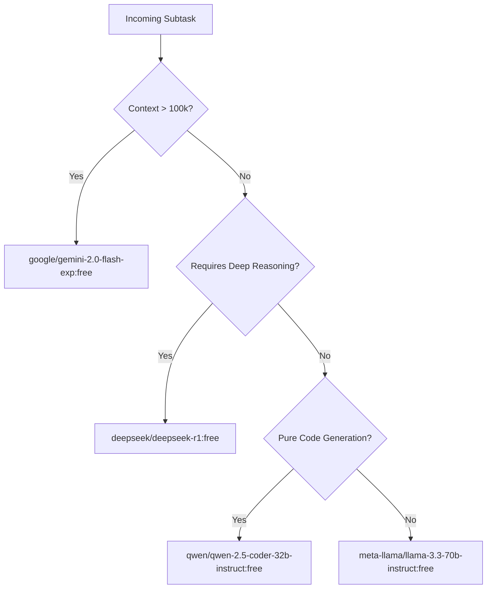

# MEGA-MODEL-EXPANSION-ENGINE

A comprehensive multi-model orchestration framework designed to expand Antigravity CLI's daily model loadout with zero-cost and high-capacity models.

---

## Sub-Skill: openrouter-free-tier-dispatch
# OpenRouter Free Tier Multi-Model Dispatch

Antigravity agents can route code reasoning, summarization, and heavy parsing tasks to OpenRouter's free-tier model catalog without burning proprietary token quotas.

### Free Model Roster & Specializations

| Model Identifier | Context Window | Specialization | Fallback Priority |
|---|---|---|---|
| `xiaomi/mimo-v2.5-pro` | 1,050,000 tokens | SOTA Multimodal Audio, Video, Photo, and Spatial Reasoning | Tier 1 (Multimodal) |
| `google/gemini-2.0-flash-exp:free` | 1,048,576 tokens | Massive context, multimodal analysis, ultra-low latency | Tier 1 (Context) |
| `deepseek/deepseek-r1:free` | 163,840 tokens | Deep mathematical & architectural reasoning, chain-of-thought | Tier 1 (Reasoning) |
| `deepseek/deepseek-chat:free` | 65,536 tokens | Fast code synthesis, general QA, structured JSON output | Tier 2 (General) |
| `meta-llama/llama-3.3-70b-instruct:free` | 131,072 tokens | Open-weights standard, compliance, factual extraction | Tier 2 (Robustness) |
| `qwen/qwen-2.5-coder-32b-instruct:free` | 32,768 tokens | Pure coding, syntax repair, test suite generation | Tier 1 (Code) |
| `mistralai/mistral-small-24b-instruct-2501:free` | 32,768 tokens | Compact fast reasoning, low latency dispatch | Tier 3 (Speed) |

### Dispatch Workflow via MCP
Call the `openrouter-free-gateway` MCP server:
```json
{
  "name": "openrouter_chat",
  "arguments": {
    "model": "google/gemini-2.0-flash-exp:free",
    "prompt": "Analyze and optimize the following Python function:\n\ndef foo(): ...",
    "temperature": 0.2
  }
}
```

---

## Sub-Skill: opencode-zen-orchestration
# OpenCode Zen CLI Orchestration

Integrates the local `/usr/local/bin/opencode` engine into the Antigravity workflow. OpenCode operates in headless and interactive modes, enabling subagent sandboxing.

### Execution Standards
1. **Headless Dispatch**: Use `--print` flag for non-interactive output extraction:
   ```bash
   opencode --print "Refactor the authentication middleware to use Bearer tokens"
   ```
2. **Model Selection**: OpenCode reads configuration from `~/.config/opencode/config.json`. Target any configured provider:
   - DeepSeek: `deepseek/deepseek-chat`
   - OpenRouter: `openrouter/deepseek/deepseek-r1:free` or `openrouter/google/gemini-2.0-flash-exp:free`
   - Local Ollama: `ollama/llama3.2:1b`

3. **Subprocess MCP Tool**:
   ```json
   {
     "name": "opencode_zen_dispatch",
     "arguments": {
       "task_prompt": "Run unit tests and fix failing assertions",
       "cwd": "/Users/kcbflux/APEX_SYSTEM/INFRASTRUCTURE/RUNTIMES/computer-user"
     }
   }
   ```

---

## Sub-Skill: cline-agentic-bridge
# Cline Autonomous Agentic Bridge

Enables Cline-style autonomous task execution pipelines inside Antigravity:
1. **Task Decomposition**: Break complex user goals into atomic steps.
2. **Tool-Loop Execution**: Run iterative edit -> compile -> test loops until verified green.
3. **State Checkpointing**: Preserve session state in Aspen Grove memory meshes.

---

## Sub-Skill: kilocode-context-compressor
# KiloCode Context Pruner & Token Cost Optimizer

KiloCode minimizes token overhead before dispatching large contexts to external models.

### Optimization Mechanics
1. **Repetitive Line Deduplication**: Strips redundant log lines and repeated tracebacks.
2. **Whitespace Compaction**: Removes superfluous empty lines and indentation padding.
3. **Symbol Salience Extraction**: Extracts class and function signatures while preserving docstrings.

### MCP Optimization Tool
```json
{
  "name": "kilocode_optimize_context",
  "arguments": {
    "context_text": "Large file or log dump...",
    "target_ratio": 0.5
  }
}
```

---

## Sub-Skill: multi-model-loadout-matrix
# Intelligent Model Selection Matrix

When selecting which model to dispatch a task to:


