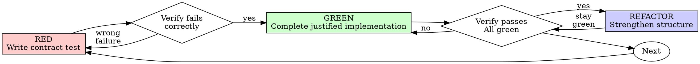

# Test-Driven Development (TDD)

## Overview

Write the contract test first. Watch it fail. Implement the strongest justified code that satisfies the complete contract and acceptance criteria, then refactor.

**Core principle:** If you didn't watch the test fail, you don't know if it tests the right thing.

TDD controls correctness and scope. It does not impose a weak capability ceiling.

## When to Use

**Always:**
- New features
- Bug fixes
- Refactoring
- Behavior changes

**Exceptions (raise them through `compose:ask`; if no user is available, use your best judgment and proceed):**
- Throwaway prototypes
- Generated code
- Configuration files

Thinking "skip TDD just this once"? Stop. That's rationalization.

## The Iron Law

```
NO PRODUCTION CODE WITHOUT A FAILING CONTRACT TEST FIRST
```

Write code before the test? Delete it. Start over.

**No exceptions:**
- Don't keep it as "reference"
- Don't "adapt" it while writing tests
- Don't look at it
- Delete means delete

Implement fresh from the contract. Period.

## Red-Green-Refactor



### RED - Write Failing Contract Test

Write a contract-focused test showing the required behavior, important edge cases, and failure handling. Keep each test coherent; do not weaken the contract to make the test convenient.

<Good>
```typescript
test('retries failed operations 3 times and returns the verified result', async () => {
  let attempts = 0;
  const operation = () => {
    attempts++;
    if (attempts < 3) throw new Error('fail');
    return 'success';
  };

  const result = await retryOperation(operation);

  expect(result).toBe('success');
  expect(attempts).toBe(3);
});
```
Clear name, tests real behavior, one coherent contract
</Good>

<Bad>
```typescript
test('retry works', async () => {
  const mock = jest.fn()
    .mockRejectedValueOnce(new Error())
    .mockRejectedValueOnce(new Error())
    .mockResolvedValueOnce('success');
  await retryOperation(mock);
  expect(mock).toHaveBeenCalledTimes(3);
});
```
Vague name, tests mock not code
</Bad>

**Requirements:**
- One coherent behavior or contract slice
- Clear name
- Real code (no mocks unless unavoidable)
- Required edge and error behavior represented

### Verify RED - Watch It Fail

**MANDATORY. Never skip.**

```bash
npm test path/to/test.test.ts
```

Confirm:
- Test fails (not errors)
- Failure message is expected
- Fails because required behavior is missing (not typos)

**Test passes?** You're testing existing behavior. Fix test.

**Test errors?** Fix error, re-run until it fails correctly.

### GREEN - Contract-Complete Implementation

Implement the complete requested contract and acceptance criteria for the behavior under test. Do not add unrelated speculative surface, but do not omit required edge cases, integration behavior, failure handling, or proof merely to make the patch smaller.

<Good>
```typescript
async function retryOperation<T>(fn: () => Promise<T>): Promise<T> {
  let lastError: unknown;
  for (let i = 0; i < 3; i++) {
    try {
      return await fn();
    } catch (error) {
      lastError = error;
      if (i === 2) throw error;
    }
  }
  throw lastError;
}
```
Complete for the declared retry contract
</Good>

<Bad>
```typescript
async function retryOperation<T>(fn: () => Promise<T>): Promise<T> {
  return fn();
}
```
Weak implementation that passes only a superficial type check
</Bad>

YAGNI means do not add unrelated speculative features. It does not mean starve the requested capability.

### Verify GREEN - Watch It Pass

**MANDATORY.**

```bash
npm test path/to/test.test.ts
```

Confirm:
- Contract tests pass
- Other tests still pass
- Output pristine (no errors, warnings)

**Test fails?** Fix code, not test.

**Other tests fail?** Fix now.

### REFACTOR - Strengthen Structure

After green only:
- Remove duplication without deleting unique behavior
- Improve names and interfaces
- Extract helpers where they increase composability
- Improve observability, resilience, and maintainability where required by the contract

Keep tests green. Don't add unrelated behavior.

### Repeat

Next contract test for the next required behavior.

## Good Tests

| Quality | Good | Bad |
|---------|------|-----|
| **Focused** | One coherent behavior. "and" in name? Split only when contracts are independent. | `test('validates email and domain and whitespace')` |
| **Clear** | Name describes behavior | `test('test1')` |
| **Shows intent** | Demonstrates desired API | Obscures what code should do |
| **Complete** | Covers required edge/error behavior | Omits behavior to keep the test easy |

## Why Order Matters

**"I'll write tests after to verify it works"**

Tests written after code pass immediately. Passing immediately proves nothing:
- Might test wrong thing
- Might test implementation, not behavior
- Might miss edge cases you forgot
- You never saw it catch the bug

Test-first forces you to see the test fail, proving it actually tests something.

## Common Rationalizations

| Excuse | Reality |
|--------|---------|
| "Too simple to test" | Simple code breaks. Test takes 30 seconds. |
| "I'll test after" | Tests passing immediately prove nothing. |
| "Already manually tested" | Ad-hoc ≠ systematic. No record, can't re-run. |
| "Need to explore first" | Fine. Throw away exploration, start with TDD. |
| "Test hard = design unclear" | Listen to test. Hard to test = hard to use. |
| "TDD will slow me down" | TDD is faster than debugging. Strong execution is test-first. |

## Red Flags - STOP and Start Over

- Code before test
- Test after implementation
- Test passes immediately
- Can't explain why test failed
- Tests added "later"
- Rationalizing "just this once"
- "I already manually tested it"
- Weakening the acceptance test to fit the implementation
- Omitting required behavior because it expands the diff

**All of these mean: Delete code. Start over with TDD.**

## Verification Checklist

Before marking work complete:

- [ ] Every new function/method has a contract test
- [ ] Watched each test fail before implementing
- [ ] Each test failed for expected reason (feature missing, not typo)
- [ ] Implemented the complete requested behavior and acceptance criteria
- [ ] All tests pass
- [ ] Output pristine (no errors, warnings)
- [ ] Tests use real code (mocks only if unavoidable)
- [ ] Edge cases and errors covered
- [ ] No unrelated speculative surface was added

Can't check all boxes? You skipped TDD. Start over.

## Final Rule

```
Production code → contract test exists and failed first → complete behavior verified
Otherwise → not TDD
```

No exceptions without your human partner's permission.
