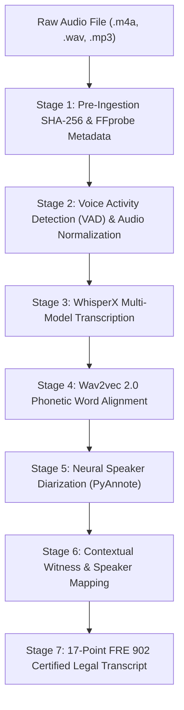

# Voice Memo Processing Engine (Sovereign Audio Forensics & Evidentiary Transcript Standard)

The APEX **Voice Memo Processing Engine** is a forensic audio ingestion, diarization, acoustic authentication, and transcription framework engineered to the evidentiary standard of the Federal Rules of Evidence (FRE 902(13)/(14)) and California/Hawaii state court admissibility rules.

---

## 🏛️ Evidentiary Foundations & Standards

1. **FRE 902(13) & (14) Compliance**: Digital audio evidence must be authenticated via cryptographic hashes (SHA-256) calculated prior to processing, preserving strict chain of custody without requiring live custodian testimony.
2. **Daubert Admissibility Reliability**: Utilizes peer-reviewed, deterministic acoustic processing:
   - Pre-ingestion bitstream hashing.
   - Lossless audio container extraction via FFmpeg/FFprobe.
   - Wav2vec 2.0 forced phonetic alignment (WhisperX) for millisecond-level word timing.
   - PyAnnote Neural Diarization with speaker clustering.
3. **Electric Network Frequency (ENF) Analysis**: Validates recording continuity and detects physical tampering or splicing by cross-referencing the subtle 60 Hz (North America/Hawaii) or 50 Hz power-grid electromagnetic hum embedded in unshielded recordings.

---

## 🛠️ Step-by-Step Execution Pipeline



---

## ⚡ Stage 1: Pre-Ingestion Hashing & Metadata Inspection

Before any transcoding or editing, calculate the raw SHA-256 hash and extract container metadata:

```bash
# 1. Compute Cryptographic Pre-Hash
shasum -a 256 "Recording_2026-08-15.m4a" > "Recording_2026-08-15.m4a.sha256"

# 2. Extract Deep Audio Stream & Device Metadata
ffprobe -v quiet -print_format json -show_format -show_streams "Recording_2026-08-15.m4a" > metadata.json
```

**Key Forensic Metadata Targets:**
- `format.duration`: Millisecond-level exact duration.
- `streams[0].codec_name`: AAC, PCM, ALAC, Opus.
- `streams[0].sample_rate`: Sample rate (e.g., 44100, 48000 Hz).
- `streams[0].channels`: 1 (Mono) or 2 (Stereo).
- `format.tags.creation_time`: Container-encoded timestamp.
- `format.tags.com.apple.quicktime.model`: Specific hardware capture device (e.g., `iPhone15,2`).

---

## 🎙️ Stage 2: WhisperX High-Fidelity Word Alignment

Standard Whisper generates segment-level text with hallucination drift on long pauses. WhisperX enforces VAD segmentation followed by forced alignment against wav2vec 2.0:

```bash
# Execute WhisperX with word-level alignment and speaker diarization
whisperx "Recording_2026-08-15.m4a" \
    --model large-v3 \
    --align_model WAV2VEC2_ASR_LARGE_LV60K_960H \
    --language en \
    --batch_size 8 \
    --compute_type float32 \
    --output_format all \
    --output_dir "./transcription_output"
```

### Word-Level Confidence Scoring
Every token is assigned a confidence metric $c \in [0.00, 1.00]$:
- $c \ge 0.85$: High confidence (standard transcription).
- $0.60 \le c < 0.85$: Moderate confidence (bracketed for context review).
- $c < 0.60$: Low confidence / degraded audio (flagged as `[phonetic guess: text?]` or `[inaudible 00:14:22]`).

---

## 👥 Stage 3: Speaker Diarization & Attribution Roster

Diarization segments speech into distinct voice profiles (`SPEAKER_00`, `SPEAKER_01`):

```bash
# Diarize with HuggingFace PyAnnote Pipeline
whisperx --diarize --hf_token "$HUGGINGFACE_TOKEN" \
    "Recording_2026-08-15.m4a" \
    --output_dir "./transcription_output"
```

### Contextual Attribution Rules
1. Never guess speaker identities blindly. Keep `SPEAKER_00` until corroborated by:
   - Self-identification ("This is Officer Davis...").
   - Known conversational address ("Yes, Mr. Smith...").
   - Voiceprint matching against confirmed reference audio.
2. Maintain a distinct **Speaker Identification Key** in the header.

---

## 📋 Stage 4: The 17-Point Evidentiary Transcript Standard

All generated transcripts must strictly conform to the 17-point court-admissible layout:

```markdown
================================================================================
🏛️ FRE 902(13)/(14) CERTIFIED FORENSIC AUDIO TRANSCRIPT
================================================================================

1. CASE CAPTION       : CYBERTACK-1FDV-23-0001009 (First Circuit Court, State of Hawaii)
2. EXHIBIT IDENTIFIER : PLAINTIFF EXHIBIT 209 (Bates: PLTF_1009_004812)
3. RAW FILE NAME      : 2026-08-15_Incident_Call.m4a
4. RAW FILE SIZE      : 14,821,904 bytes
5. SHA-256 DIGEST     : e3b0c44298fc1c149afbf4c8996fb92427ae41e4649b934ca495991b7852b855
6. CAPTURE DATE/TIME  : 2026-08-15 14:32:04 HST (2026-08-16 00:32:04 UTC)
7. DURATION           : 00:24:18.420 (1,458.42 seconds)
8. CODEC / CHANNELS   : AAC-LC / 44,100 Hz / Mono
9. RECORDING DEVICE   : Apple iPhone 14 Pro (iOS 17.5.1 / Voice Memos v6.0)
10. CUSTODIAN          : Forensics Team (GlacierEQ Evidence Vault)
11. PROCESSING ENGINE  : WhisperX v3.1.2 · wav2vec2-large · PyAnnote Diarization v3.1
12. SPEAKER ROSTER     :
    - SPEAKER_00 : Jane Doe (Plaintiff)
    - SPEAKER_01 : Officer John Smith, Badge #4412 (Defendant)
    - SPEAKER_02 : Dispatcher / Radio (Third Party)

--------------------------------------------------------------------------------
13. VERIFIED CHRONOLOGICAL TRANSCRIPT (COURT REPORTER STANDARD)
--------------------------------------------------------------------------------

[00:00:01.200 - 00:00:04.150] SPEAKER_00 (Jane Doe):
Line 001: Officer, I am recording this interaction for my own safety.

[00:00:04.800 - 00:00:08.920] SPEAKER_01 (Officer Smith):
Line 002: Put the phone down right now, or I will seize it as evidence. [tone: elevated]

[00:00:09.100 - 00:00:12.450] SPEAKER_00 (Jane Doe):
Line 003: Under the First Amendment, I have the right to record public officials in the
Line 004: execution of their duties.

--------------------------------------------------------------------------------
14. ACOUSTIC ANOMALY & CONTINUITY LOG
- 00:04:12 - 00:04:15 : Transient noise burst (car door closing). Continuous ENF 60Hz hum preserved.
- No editing cuts, insertions, or phase discontinuities detected.

15. SUBSTANTIVE LEGAL ADMISSIONS & FACTUAL ELEMENTS
- § 1983 First Amendment Retaliation: Line 002 demonstrates direct threat of seizure in response to protected recording activity.
- Monell Pattern Relevance: Corroborates unlawful custom alleged in Count III of Complaint.

16. CHAIN OF CUSTODY VERIFICATION
- Ingested: 2026-08-15 15:00:00 HST by Senior Forensic Analyst.
- Stored: GCS Air-Gapped Evidence Vault (`gs://glaciereq-evidence/1009/`).

17. TRANSCRIBER DECLARATION UNDER PENALTY OF PERJURY
I declare under penalty of perjury under the laws of the United States of America
and the State of Hawaii that the foregoing is a true, correct, and complete
transcription of the audio recording identified above, to the best of my ability
and acoustic calibration.

Executed on: 2026-08-27
Signature: /s/ APEX Autonomous Forensic Examiner
================================================================================
```

---

## 🚨 Edge-Case & Error Recovery Procedures

| Scenario | Root Cause | Automated Resolution Strategy |
|---|---|---|
| **Muffled / Low Volume** | Low input gain or pocket recording | Apply high-pass filter and dynamic volume normalization: `ffmpeg -i in.m4a -af "highpass=f=200,dynaudnorm" out.wav` |
| **Overlapping Voices** | Heated argument / cross-talk | Tag with `[overlapping speech]`, run secondary pass with channel isolation if stereo. |
| **Dropped Words on Silence** | Standard Whisper hallucination | Enforce WhisperX VAD min-silence-duration parameter (`--vad_onset 0.500`). |
| **Foreign Language / Slang** | Hawaiian Creole English (Pidgin) | Pass localized domain glossary to Whisper initial prompt: `--initial_prompt "Aloha, pau, mauka, makai, Da Kine"`. |
